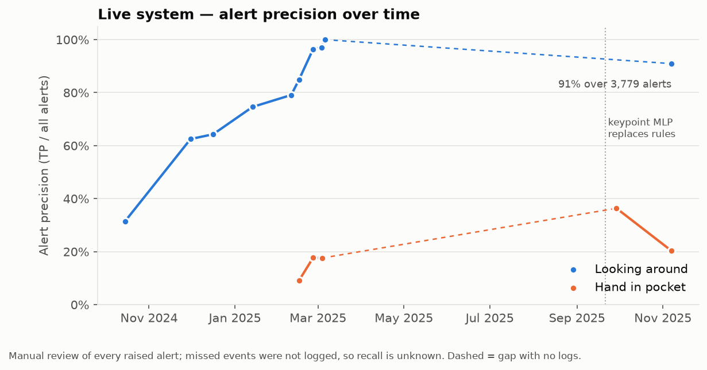

# Qiyas — keypoint-based exam-hall behaviour recognition

Research code, results and lessons from building the behaviour-recognition models of the **Qiyas**
AI exam-hall monitoring system — work done as an AI Developer at Lambda Theta with the ELM research
team (Oct 2024 – Jan 2026).

One custom pose model watches every desk; three behaviours are decided from its keypoints:
**looking around**, **hand raise** and **hand in pocket**. Over 15 months I trained 16 pose-model
versions, tried more than 20 behaviour approaches, from geometric rules and gradient boosting to
temporal CNNs and CNN + MLP hybrids, and took the winners into a live multi-camera system.

> **What this repository is:** my experiment code, re-implemented cleanly as a tested package,
> plus the measured results and what I learned.
> **What it is not:** the production system (owned by the product team), the datasets or the model
> weights. Footage of real candidates never leaves the deployment, so every pipeline here also runs
> on synthetic data.



## Results at a glance

| | Result | Evaluation |
|---|---|---|
| **Pose model** | custom 10-keypoint YOLO11l-pose, 16 runs; v8-1 in production. TensorRT FP16 export ≈ **2× throughput** | val split · benchmark |
| **Looking around** | ear-line-angle rule on the fine-tuned pose model: **P 1.00 / R 0.71** on 27 test videos (vs P 0.70 / R 0.67 for an image classifier) | video bench, events |
| | live alert precision **63 % → 97 %** over four months; **91 % over 3,779 alerts** in a 2-week production log | live alert review |
| **Hand in pocket** | 12 approaches on one 14-video bench: best **F1 0.89** (keypoint MLP + augmentation) vs 0.53 for the rule-based system it replaced | video bench, events |
| | deployed Sep 2025; on replayed live footage **−92 % false alerts** vs the rule system, with a recall cost (fewer true alerts) | live alert review |
| **Hand raise** | six approaches, honest negative result: best **F1 0.56**; documents an accuracy paradox (97 % = majority class) and frame-level leakage (mAP 0.995 → 3 hits in 160 test frames) | video-held-out val · test video |

Every number is traceable to a table in [`results/`](results/) with an `eval_type` column; how much to
trust each type is explained in [docs/06](docs/06-evaluation-lessons.md).

## Read the story

| | |
|---|---|
| [0 · Overview](docs/00-overview.md) | problem, constraints, what is mine vs context, timeline |
| [1 · Pose model](docs/01-pose-model.md) | custom skeleton, 16 runs, YOLOv8 vs YOLO11, TensorRT |
| [2 · Looking around](docs/02-looking-around.md) | geometry rules vs image classifier, depth-aware thresholds, live results |
| [3 · Hand raise](docs/03-hand-raise.md) | six approaches and why they failed — a documented negative result |
| [4 · Hand in pocket](docs/04-hand-in-pocket.md) | data pipeline, 12 approaches, the deployed MLP, live re-evaluation, verifier prototype |
| [5 · System integration](docs/05-system-integration.md) | the deployment contract the models had to satisfy |
| [6 · Evaluation lessons](docs/06-evaluation-lessons.md) | leakage, accuracy paradox, frozen ground truth, silent bugs |

## Repository map

```
src/qiyas_akd/
  keypoints.py        10-keypoint schema, normalisation conventions (shared by everything)
  desks.py            camera / desk layout, person → desk assignment
  evaluation.py       event extraction, TP/FP/FN matching, video-grouped splits
  synthetic.py        synthetic seated-candidate keypoint sequences
  extract.py          video → per-desk keypoint table (pose model injected)
  pose/               dataset config, fine-tuning, TensorRT export, throughput benchmark
  looking_around/     ear-line / centre-angle / triangle rules, depth-aware thresholds, detector
  hand_raise/         features, rule baseline, MLP / RF / hybrid models, training
  hand_in_pocket/     windowing, label rules, balancing, augmentation, 8 model families, training, streaming inference
configs/              YAML configs per experiment (no real camera data)
results/              curated metric tables (counts; metrics are computed from them)
scripts/              make_figures.py · sanitize_check.py (publication gate)
docs/                 the write-up and generated figures
tests/                unit + integration tests (run on synthetic data, CPU only)
```

## Quick start

```bash
python -m venv .venv && source .venv/bin/activate      # Windows: .venv\Scripts\activate
pip install torch --index-url https://download.pytorch.org/whl/cpu
pip install -e ".[dev]"          # add ".[pose]" for Ultralytics fine-tuning / export

pytest                                   # full test suite (synthetic data, CPU)
python examples/make_synthetic_dataset.py --out data/synthetic
python -m qiyas_akd.hand_in_pocket.train --config configs/hand_in_pocket/mlp_t3.yaml --synthetic
python scripts/make_figures.py           # regenerate docs/figures from results/
```

## Licence

[AGPL-3.0](LICENSE) — the pose tooling builds on Ultralytics YOLO, which is AGPL-3.0.

Author: **Wajahat Ahmed** · [github.com/wajahatah](https://github.com/wajahatah)
