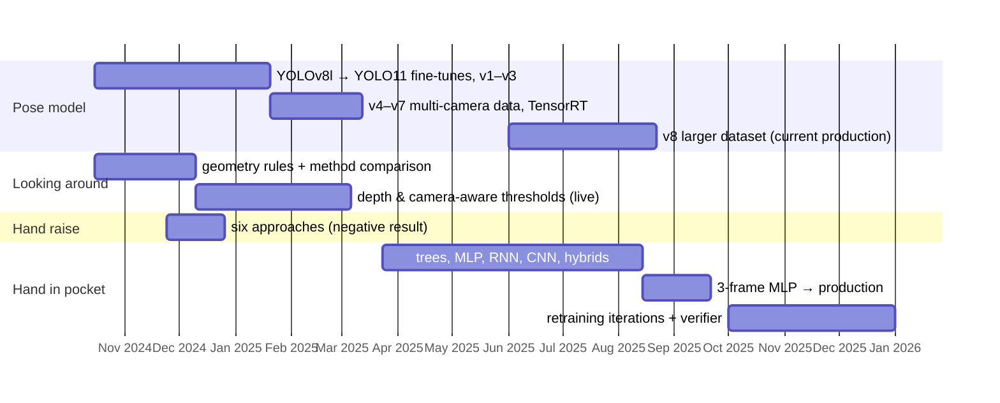

# 0 · Overview

## The problem

**Qiyas** national exams are taken in monitored exam halls. The AI monitoring system watches the
halls through fixed ceiling cameras (each covering several desks) and raises alerts for suspicious
behaviour so that a small number of invigilators can watch many candidates. I worked on this
system as an **AI Developer at Lambda Theta**, with the **ELM** research team (Oct 2024 –
Jan 2026): I built its pose model and researched the behaviour models for three alert types:

| Behaviour | Why it matters | Hard part |
|---|---|---|
| **Looking around** | copying from a neighbour | normal head movement looks similar; perspective differs per seat |
| **Hand raise** | candidate needs the invigilator | short, rare events; few examples per video |
| **Hand in pocket** | reaching for a phone or notes | the hand is occluded by the desk |

## Constraints that shaped every decision

- **Fixed, elevated viewpoint, seated people.** Legs are never visible → custom upper-body skeleton.
- **Many cameras, one GPU budget.** One pose pass must serve every behaviour → behaviours are
  decided from keypoints, not from extra image models.
- **Invigilator trust.** Every false alert costs invigilator attention → precision is the
  operational metric, measured on real alerts.
- **Privacy.** Footage of real candidates cannot leave the deployment → this repository contains
  code, metrics and diagrams only.

## My contribution vs. context

| Mine | Context (not claimed) |
|---|---|
| custom 10-keypoint pose model: 16 fine-tuning runs, size/backbone sweeps, TensorRT export | the multi-camera production pipeline, alert logic and dashboard |
| looking-around geometry rules, depth/camera-aware thresholds, method comparison | the gaze-target and head-classifier baselines; the later polynomial threshold |
| hand-raise: six approaches and their (negative) evaluation | the detector used live for hand raise |
| hand in pocket: data pipeline, annotation tooling, 12 approaches, the deployed MLP, the verifier prototype | the rule-based baseline it replaced |
| test-bench evaluations and live-alert reviews summarised in `results/` | |

## Timeline

