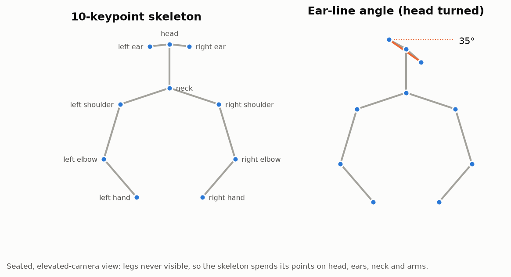
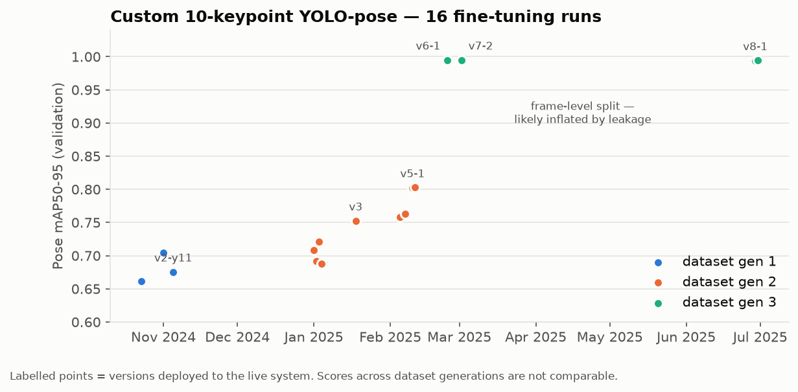
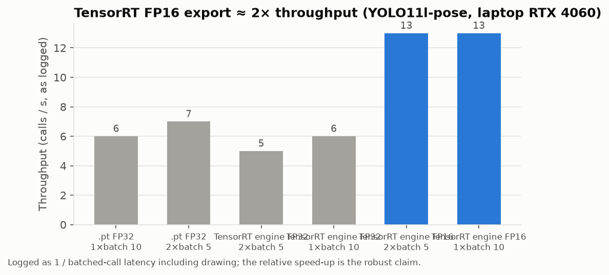

# 1 · The custom 10-keypoint pose model

Everything in this project stands on one model: a YOLO-pose network fine-tuned to a **custom
10-keypoint upper-body skeleton**. All three behaviours are decided from its output.

## Why a custom skeleton

Exam candidates are filmed by ceiling-mounted cameras, seated behind desks. COCO's 17 keypoints
spend 6 points on hips, knees and ankles that are never visible here, and have no *neck*. The
behaviours we needed are about the **head direction** (looking around) and the **arms and hands**
(hand raise, hand in pocket), so the skeleton was redesigned around them:

| # | Keypoint | Used for |
|---|---|---|
| 0 | head | desk assignment, head direction |
| 1 | neck | upper-body anchor, invigilator facing |
| 2, 3 | left / right ear | **ear-line angle** (looking around) |
| 4–6 | left shoulder / elbow / hand | arm pose (hand raise, hand in pocket) |
| 7–9 | right shoulder / elbow / hand | arm pose |

Schema and conventions: [`src/qiyas_akd/keypoints.py`](../src/qiyas_akd/keypoints.py) ·
dataset config: [`src/qiyas_akd/pose/`](../src/qiyas_akd/pose/).

## 16 fine-tuning runs

| Phase | What changed | Outcome |
|---|---|---|
| Oct–Nov 2024 | YOLOv8l-pose fine-tunes (first 6 layers frozen); a series of early runs collapsed to 0 mAP before a stable configuration was found | first usable model (pose mAP50 0.94–0.97) |
| Nov 2024 | switch to YOLO11l-pose | first model deployed to the live system (6 Dec 2024) |
| Jan 2025 | **size sweep** — YOLO11 s / m / l and a YOLOv8l control on the same data | YOLO11l kept; on looking-around videos YOLO11 removed all false alerts of the YOLOv8 model (precision 0.75 → 1.00, [§2](02-looking-around.md)) |
| Jan–Feb 2025 | data growth across cameras (76 → 116 → 137 annotated videos from 1 → 3 cameras, balanced with/without headphones), freeze 6 vs 4 vs none | v3, v5-1 deployed |
| Feb–Jun 2025 | larger re-annotated dataset (≈245k person instances, 80/20 split), longer schedules | v7-2 (Mar 2025) and **v8-1 (current production, Aug 2025)** |

An MMPose-based alternative was also trialled during model selection; its results were not
preserved, so it is not compared quantitatively here.

Full table: [`results/pose_model_iterations.csv`](../results/pose_model_iterations.csv).

### Reading the validation numbers honestly

The jump from ≈0.80 to ≈0.99 pose mAP50-95 at v6 coincides with a new dataset **and** a random
frame-level train/val split. Consecutive video frames are near-duplicates, so the validation set
contained near-copies of training frames. Those scores say the model fits the data; they do not
measure generalisation. The trustworthy evidence of model quality is downstream and controlled:
the same looking-around rule on the same 27 test videos went from precision 0.75 (YOLOv8) to 1.00
(YOLO11 fine-tune) ([§2](02-looking-around.md)). Live precision also rose with later releases, but
those coincided with threshold changes, so they are not attributed to the pose model alone. The
re-implementation here splits by **video** (`pose.dataset`, [§6](06-evaluation-lessons.md)).

A second, silent issue: the original dataset config declared `flip_idx: []`. Ultralytics then
disables horizontal-flip augmentation without warning (the run logs still show `fliplr: 0.5`). The
config writer in this repo emits the correct left/right swap table by default.

A third, found while re-auditing the runs: every run used `optimizer=auto`, under which Ultralytics
picks the optimiser *and learning rate* itself and ignores `lr0` / `momentum`. The learning-rate
values varied across runs (0.01 → 0.0001 → 0.001) therefore never reached the optimiser. The
training wrapper here warns when that combination is configured.

## Deployment speed: TensorRT FP16

`v7-2` was exported PyTorch → ONNX (opset 19) → TensorRT 10.9 and benchmarked on a laptop
RTX 4060 with batch 5 / 10 and one or two parallel processes. FP32 engines gave no gain over
PyTorch; **FP16 engines roughly doubled throughput** (13 vs 6–7). The logged figure was
1 / batched-call latency including drawing, so only the relative speed-up is claimed. The
benchmark in this repo times inference alone and reports frames/s and batches/s separately
(`pose.benchmark`).
