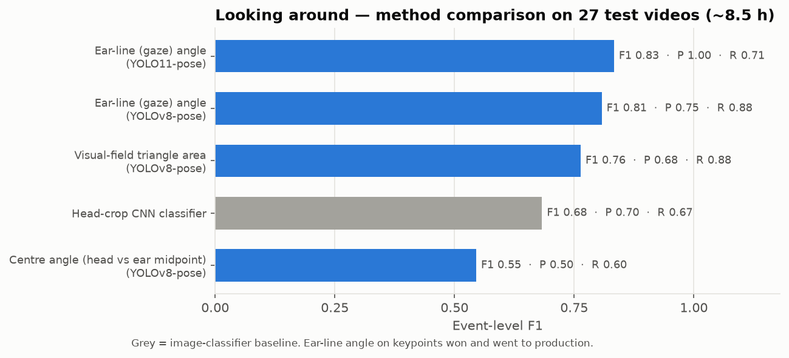
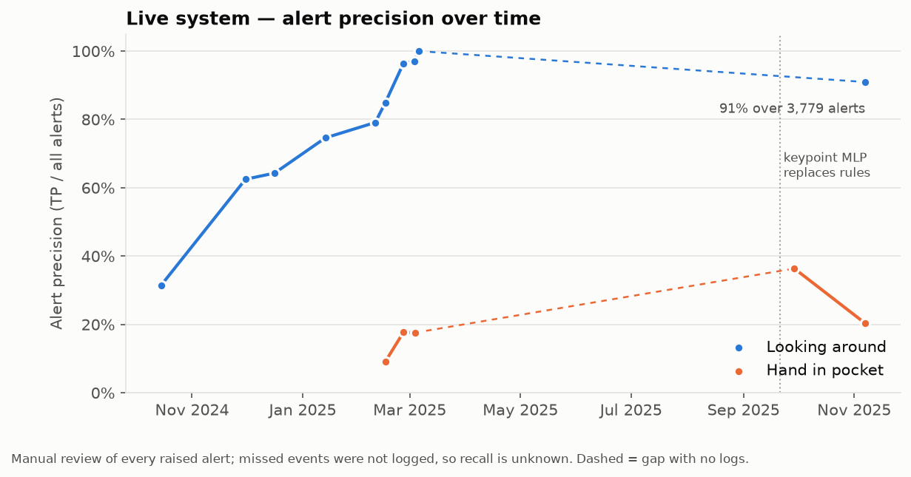

# 2 · Looking around

**Goal:** flag a candidate who turns their head toward a neighbour, without flagging normal
movement (reading, stretching, looking at the invigilator's clock).

## Approaches, in order

| # | Approach | Idea | Status |
|---|---|---|---|
| 0 | Gaze-target model (system baseline) | gaze-following network predicts where each person looks | replaced by the pose approach (Nov 2024) |
| 1 | Head-crop image classifier | grayscale head crop → small CNN → looking / not looking | baseline in the comparison below |
| 2 | Centre angle | angle of the line from the ear midpoint to the head point | dropped |
| 3 | Visual-field triangle | perpendicular foot of the head on the ear line defines a view triangle; flag when the head leaves it | competitive recall, more false alerts |
| 4 | **Ear-line angle** | angle of the left-ear → right-ear line; a frontal head keeps it near horizontal, a turned head tilts it | **won → production** |
| 5 | Depth-aware thresholds | the allowed angle shrinks with distance from the camera (heads far from the camera look more tilted for the same turn): `allowed = base − k · depth`, with a per-camera base angle depending on whether the head is inside or outside the desk band | production |

All geometry lives in [`src/qiyas_akd/looking_around/`](../src/qiyas_akd/looking_around/).
Missing-ear handling matters in practice: with one ear occluded the angle is undefined, so no
decision is made for that frame (it counts as "not looking around") instead of guessing from a
broken line. I also fitted my own polynomial depth threshold (shipped as an option in
`looking_around.thresholds`); the linear rule is the default.

## Offline comparison — 27 test videos (~8.5 h)

| Method | Pose model | TP | FP | FN | Precision | Recall | F1 |
|---|---|---|---|---|---|---|---|
| Head-crop CNN classifier | – | 14 | 6 | 7 | 0.70 | 0.67 | 0.68 |
| Centre angle | YOLOv8 | 15 | 15 | 10 | 0.50 | 0.60 | 0.55 |
| Visual-field triangle | YOLOv8 | 21 | 10 | 3 | 0.68 | 0.88 | 0.76 |
| Ear-line angle (60°) | YOLOv8 | 21 | 7 | 3 | 0.75 | 0.88 | 0.81 |
| **Ear-line angle (70°)** | **YOLO11** | 15 | **0** | 6 | **1.00** | 0.71 | **0.83** |

Caveat: the number of ground-truth events (TP + FN) varies between rows (21–25), i.e. the reference
was not frozen between runs. The ranking is consistent, but differences of one or two events should
not be over-read. Source: [`results/looking_around_methods.csv`](../results/looking_around_methods.csv).

## In the live system

Every alert raised by the live system was reviewed by hand and marked correct or false:

| Period | Pose model | Logic | Alerts | Precision |
|---|---|---|---|---|
| Oct 2024 | – (gaze-target baseline) | – | 54 | 31 % |
| Nov–Dec 2024 (1 camera) | v2 | ear-line angle | 60 | 63 % |
| Jan 2025 (10 cameras) | v2 | + desk ROI | 63 | 75 % |
| 11–20 Feb 2025 | v5-1 | + per-camera base angles | 469 | 85 % |
| 24 Feb – 6 Mar 2025 | v6-1 / v5-1 → v7-2 | depth factor tightened (k 30 → 15) | 390 | **97 %** |
| Nov 2025 (2-week log, 9 days) | v8-1 | polynomial depth threshold | 3,779 | **91 %** |

The production team later replaced the linear depth rule with a fitted polynomial threshold; the
Nov 2025 row measures that configuration on the pose model trained here. These logs measure
precision only — missed events were never counted live ([§6](06-evaluation-lessons.md)).
Source: [`results/live_precision_timeline.csv`](../results/live_precision_timeline.csv).

## What I learned

- **A geometric rule on good keypoints beat a learned image classifier** — and it is explainable to
  invigilators ("the head turned more than X°").
- **The pose model was the lever.** The same rule went from 0.75 to 1.00 precision when YOLOv8 was
  replaced by the YOLO11 fine-tune.
- **Perspective must be modelled.** One global angle cannot serve 10+ cameras at different heights.
  Live precision went from 75 % to 97 % as the threshold became depth- and camera-aware (alongside
  pose-model releases, so the two effects are not separated).
