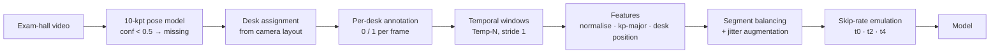
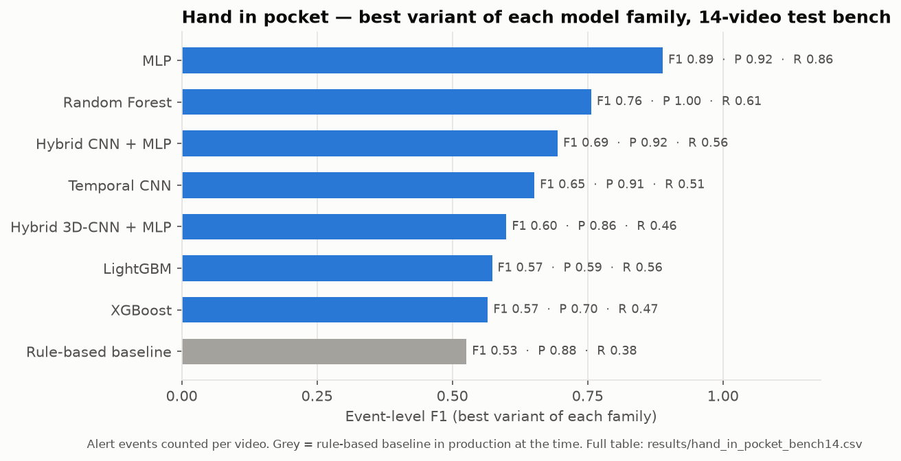
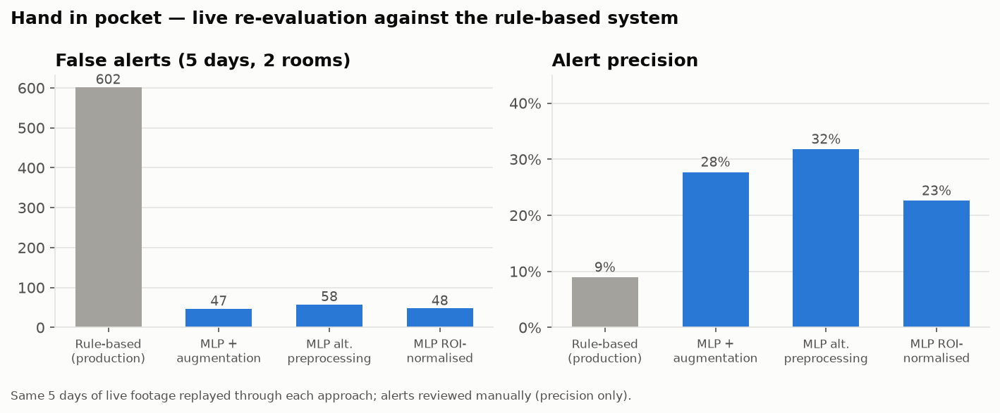

# 4 · Hand in pocket — the main research line

**Goal:** flag a candidate whose hand goes into a pocket (a common way to reach a phone or notes).
This is the hardest of the three behaviours: the hand is usually **occluded by the desk**, the
event is rare (≈ 9 % of desk-frames), and from a ceiling camera "hand in pocket", "hand on lap" and
"hand on the chair's arm rest" look almost the same.

Ten months (Mar 2025 – Jan 2026), 12 approaches, one deployed model.

## 1. Data pipeline

Each stage is a module in [`src/qiyas_akd/hand_in_pocket/dataprep/`](../src/qiyas_akd/hand_in_pocket/dataprep/):

- **Annotation tooling.** Keypoints are extracted per frame and assigned to desks; a keyboard-driven
  tool labels one desk at a time, with auto-fill for long unchanged stretches and automatic all-zero
  labels for clips known to be false alerts — labels attach to a desk's keypoint sequence, so no
  boxes need drawing.
- **Temporal windows (Temp-N).** N consecutive frames per desk become one row of `N × 20`
  coordinates. Label rules were studied explicitly: **any-one** (row is positive if any frame is),
  **all-one** (only if every frame is) and **50 %**.
- **Features.** `x / 1280`, `y / 720`, missing → −1, rounded to 3 decimals to suppress keypoint
  noise; **kp-major ("regrouped") column order** so
  each coordinate's time steps are adjacent; a 4-value **desk-position** descriptor, because
  perspective changes what a pocketed hand looks like from each seat.
- **Balancing.** Keep every positive segment plus context on both sides, cap all-negative desks —
  instead of random row sampling, which kept near-duplicate negatives.
- **Augmentation.** ±4 px jitter on positive windows.
- **Skip-rate emulation.** The live system samples every 2nd frame. Training on frames
  `t0, t2, t4` of a 5-frame window ("t3", 3 × 20 + 4 = **64 inputs**) makes the training input
  identical to what the model sees in production.

Dataset growth: 70 → 140 → 501 → 1,114 annotated videos; the final training set is ≈ 125k
windows after balancing. Dataset-version study (label rule × balancing × rounding × window
length): [`results/hand_in_pocket_dataset_versions.csv`](../results/hand_in_pocket_dataset_versions.csv).

## 2. Twelve approaches on one test bench

All approaches were run on the **same 14 bench videos** and scored by counting alert events
(TP / FP / FN per video).

| Family | Best variant | P | R | F1 |
|---|---|---|---|---|
| Rule-based baseline (production at the time) | angle + motion-sequence rules | 0.88 | 0.38 | 0.53 |
| Random Forest, single frame | keypoints | 0.94 | 0.35 | 0.51 |
| XGBoost / LightGBM, 5-frame | normalised keypoints | 0.70 / 0.59 | 0.47 / 0.56 | 0.57 / 0.57 |
| Hybrid 3D-CNN + keypoint MLP | desk-crop clip + keypoints | 0.86 | 0.46 | 0.60 |
| Temporal CNN | 5 stacked grayscale frames | 0.91 | 0.51 | 0.65 |
| Hybrid 2D-CNN + keypoint MLP | desk crops + keypoints | 0.92 | 0.56 | 0.69 |
| Random Forest, 5-frame | normalised + grid search | 1.00 | 0.61 | 0.76 |
| MLP, 5-frame | normalised, kp-major + position | 0.95 | 0.76 | 0.84 |
| **MLP, 5-frame + rounding + jitter augmentation** | (round 2) | **0.92** | **0.86** | **0.89** |

Also tried, without bench totals recorded: single-frame ResNet18 and a custom CNN on full frames,
LSTM / GRU sequence models (keypoint sequences of 5 × 24), XGBoost/LightGBM grid searches.

Two evaluation rounds: in round 1 the ground-truth event count was not frozen (TP + FN varies
29–70 between rows), so compare round-1 rows mainly on precision; round 2 fixed it at 42 events.
Full table (59 variants): [`results/hand_in_pocket_bench14.csv`](../results/hand_in_pocket_bench14.csv).

**Why the keypoint MLP won:** best F1 on the bench; it reuses the pose model the live system already
runs (no extra image model per desk); all desks of all cameras go through one batched forward pass;
and it is small (64 → 64 → 32 → 1), which kept the many dataset-design iterations above cheap.
The image and hybrid models were heavier and did not beat it.

## 3. From bench to production

**Live re-evaluation (Aug 2025).** Five days of footage from two exam rooms, replayed through each
approach, every alert reviewed by hand:

| Approach | True alerts | False alerts | Precision |
|---|---|---|---|
| Production rule-based system | 59 | 602 | 9 % |
| MLP + augmentation (this work) | 18 | 47 | 28 % |
| MLP, alternative preprocessing | 27 | 58 | 32 % |
| MLP, ROI-normalised | 14 | 48 | 23 % |

The MLPs cut false alerts by ~92 % — the main complaint about the rule system — but they also
raised fewer true alerts (59 → 14–27). Missed events were not logged live, so recall cannot be
computed; the drop in true alerts says the MLP traded recall for precision.

**Deployment.** The 3-frame MLP (`t3`) went live on 21 Sep 2025, with keypoint sanity gates in the
live pipeline (head inside a detected head box, shoulders inside the desk ROI, not all arm points
missing). The current production version (`t5`) is the same pipeline retrained with revised data
preprocessing.

| Live period | Approach | Alerts | Precision |
|---|---|---|---|
| Feb – Mar 2025 | rule-based | 1,084 | 17 % |
| 28–30 Sep 2025 | MLP (`t3`) | 99 | 36 % |
| Nov 2025 (2-week log) | MLP | 1,115 | 20 % |

Hand in pocket remains the least precise behaviour in the system. On a larger 77-video bench the
`t3` model reached P 0.88 but R 0.46; reviews of the remaining false alerts pointed to postures
that look alike as keypoints (hand on lap, on the arm rest, under the desk) — the motivation for
the verifier below.

## 4. Next step that was prototyped: a hand-state verifier

To separate the look-alike poses, I trained a YOLOv8m detector on per-hand boxes in 11 hand-state
classes (on desk, lap, arm rest, head, back, under desk, in pocket, suspected, …), split **by
video**, to veto MLP alerts whose hands are visibly elsewhere.

| Detector | mAP50 | mAP50-95 |
|---|---|---|
| all 11 classes | 0.57 | 0.31 |
| pocket + suspected only | **0.68** | 0.38–0.43 |
| 6 non-pocket states (the veto set) | 0.33 | 0.17 |

The veto classes were the weakest (class imbalance: e.g. 60 pocket boxes vs 8,677 of the most
common class), and an annotation review found inconsistent labelling of arm-rest and partially
visible hands, so the verifier stayed a prototype. Source:
[`results/hand_in_pocket_detector.csv`](../results/hand_in_pocket_detector.csv).

## What I learned

- **Match training to deployment.** The single biggest practical fix was emulating the live frame
  skip in the training windows (`t3`).
- **Label rules are a design choice.** Any-one vs all-one labelling changed recall more than most
  architecture changes.
- **Balance by segment, not by row.** Rows from one video are near-duplicates; balancing whole
  segments kept the hard negatives that matter.
- **Precision is the product metric** for an alerting system people must trust — but report the
  recall cost alongside it.
