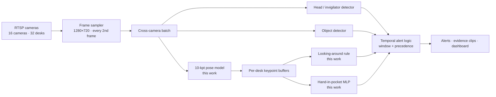

# 5 · How the models fit into the live system

The multi-camera production pipeline was built and is owned by the production engineering team;
its code is not part of this repository. This page describes only the interfaces my models had to
satisfy, because those constraints shaped the research.

## Contracts my models had to honour

| Constraint from the live system | Consequence in the research |
|---|---|
| Every 2nd frame is processed | train on `t0, t2, t4` of a 5-frame window → the 3-frame (`t3`) MLP |
| One pose pass serves all behaviours | behaviour models consume keypoints, not images — no per-desk image model |
| All cameras are batched together | per-desk models must batch (the MLP scores every desk in one forward pass) |
| Desks are fixed per camera | features carry a desk-position descriptor; thresholds are calibrated per camera |
| Keypoints with confidence < 0.5 are dropped | training data uses the same masking, missing → −1 |
| Alerts are smoothed over a short window | single-frame blips matter less than sustained false positives — evaluate per **event** |

The same conventions are encoded once in [`src/qiyas_akd/keypoints.py`](../src/qiyas_akd/keypoints.py)
and [`src/qiyas_akd/desks.py`](../src/qiyas_akd/desks.py), so training and inference cannot drift
apart.
